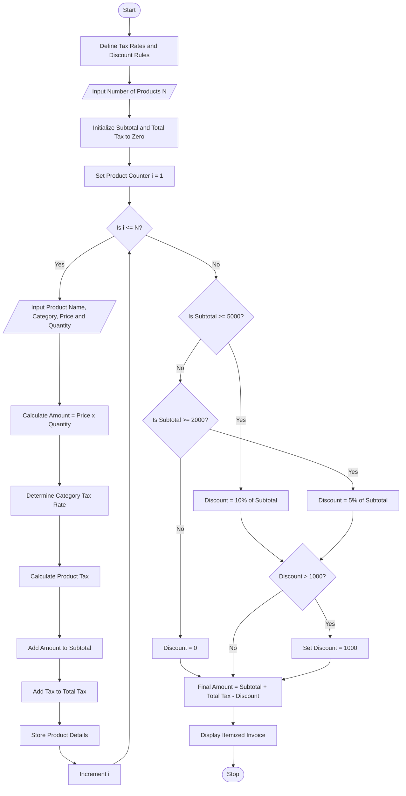

# Retail Billing System with Multiple Discount Rules Using Python

## 1. Problem Statement

Develop a Python program to implement a retail billing system that processes multiple products, their prices, and quantities. The system should calculate the subtotal, apply category-specific taxes, and provide discounts based on purchase amount thresholds. It should also enforce a maximum concession limit to prevent excessive discounts. Finally, the program should generate an itemized invoice displaying product details, quantities, prices, taxes, discounts, and the final amount payable.

## 2. Algorithm

1. **Start** the program.
2. Define tax rates for different product categories.
3. Set the discount thresholds and maximum concession limit.
4. Input the number of products.
5. For each product:
   - Read the product name, category, price, and quantity.
   - Calculate the product amount as price × quantity.
   - Determine the applicable tax rate.
   - Calculate the product tax.
   - Add the amount and tax to their respective totals.
6. Calculate the subtotal of all products.
7. Apply a discount based on the subtotal:
   - Below ₹2,000: No discount.
   - ₹2,000 to below ₹5,000: 5% discount.
   - ₹5,000 or above: 10% discount.
8. Limit the discount to a maximum of ₹1,000.
9. Calculate the final amount payable by adding total tax to the subtotal and subtracting the discount.
10. Display the itemized invoice.
11. **Stop** the program.

## 3. Flowchart Using Mermaid

# Apply threshold-based discounts
if subtotal >= 5000:
    discount = subtotal * 0.10
elif subtotal >= 2000:
    discount = subtotal * 0.05
else:
    discount = 0

# Apply maximum concession limit
discount = min(discount, MAX_CONCESSION)

# Calculate final payable amount
final_amount = subtotal + total_tax - discount

# Generate itemized invoice
print("\n" + "=" * 85)
print("                         RETAIL INVOICE")
print("=" * 85)

print(
    f"{'Product':<15}{'Category':<15}{'Qty':<6}"
    f"{'Price':<10}{'Amount':<10}{'Tax %':<8}{'Tax':<10}"
)

print("-" * 85)

for p in products:
    print(
        f"{p['name']:<15}{p['category']:<15}"
        f"{p['quantity']:<6}{p['price']:<10.2f}"
        f"{p['amount']:<10.2f}{p['tax_rate']:<8}"
        f"{p['tax']:<10.2f}"
    )

print("-" * 85)
print(f"Subtotal                 : Rs. {subtotal:.2f}")
print(f"Total Tax                : Rs. {total_tax:.2f}")
print(f"Discount                 : Rs. {discount:.2f}")
print(f"Maximum Concession       : Rs. {MAX_CONCESSION:.2f}")
print(f"Final Amount Payable     : Rs. {final_amount:.2f}")
print("=" * 85)
print("       Thank you for shopping with us!")

## 5. Sample Input

===== RETAIL BILLING SYSTEM =====
Enter number of products: 3

Enter details for Product 1
Product name: Rice
Category (food/clothing/electronics/other): food
Price per unit: 1000
Quantity: 2

Enter details for Product 2
Product name: Shirt
Category (food/clothing/electronics/other): clothing
Price per unit: 500
Quantity: 2

Enter details for Product 3
Product name: Headphones
Category (food/clothing/electronics/other): electronics
Price per unit: 2000
Quantity: 

## 6. Sample Output

text
=====================================================================================
                         RETAIL INVOICE
=====================================================================================
Product        Category       Qty   Price     Amount    Tax %   Tax
-------------------------------------------------------------------------------------
Rice           food           2     1000.00   2000.00   5       100.00
Shirt          clothing       2     500.00    1000.00   12      120.00
Headphones     electronics    1     2000.00   2000.00   18      360.00
-------------------------------------------------------------------------------------
Subtotal                 : Rs. 5000.00
Total Tax                : Rs. 580.00
Discount                 : Rs. 500.00
Maximum Concession       : Rs. 1000.00
Final Amount Payable     : Rs. 5080.00
=====================================================================================
       Thank you for shopping with us!

