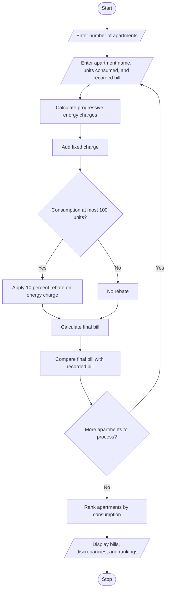

# 77. Smart Electricity Billing for Multiple Apartments

## 1. PROBLEM STATEMENT

Develop a Python program to calculate electricity bills for multiple apartments using progressive tariff rates, fixed charges, and rebates.

The program should:
- Accept the number of apartments and their electricity consumption in units.
- Calculate electricity charges using progressive tariff slabs.
- Add fixed charges to each apartment's bill.
- Apply rebates when eligible.
- Identify billing discrepancies by comparing the calculated bill with the recorded bill.
- Rank apartments from highest to lowest electricity consumption.
- Display each apartment's bill, rebate, discrepancy, and consumption rank.

**Assumed tariff rates for this example:**

| Electricity consumption | Rate per unit |
|---|---:|
| First 100 units | ₹2 |
| Next 100 units | ₹3 |
| Above 200 units | ₹5 |

- Fixed charge: ₹50 per apartment.
- Rebate: 10% on the energy charge when consumption is at most 100 units.
- A billing discrepancy is identified when the recorded bill differs from the calculated bill.

These are illustrative rates for the programming exercise, not official electricity tariffs.

## 2. ALGORITHM

1. Start.
2. Input the number of apartments.
3. For each apartment, input its name, electricity consumption, and recorded bill.
4. Calculate the energy charge using progressive tariff slabs.
5. Add the fixed charge to the energy charge.
6. Check rebate eligibility and subtract any applicable rebate.
7. Calculate the final bill.
8. Compare the final bill with the recorded bill to identify discrepancies.
9. Store the apartment details and calculated bills.
10. Rank apartments by electricity consumption in descending order.
11. Display apartment-wise bills, rebates, discrepancies, and consumption rankings.
12. Stop.

## 3. FLOWCHART (Mermaid)




## 5. SAMPLE INPUT

```text
Enter number of apartments: 3

Apartment 1
Enter apartment name: A101
Enter units consumed: 80
Enter recorded bill (Rs.): 194

Apartment 2
Enter apartment name: A102
Enter units consumed: 150
Enter recorded bill (Rs.): 360

Apartment 3
Enter apartment name: A103
Enter units consumed: 250
Enter recorded bill (Rs.): 800

## 6. SAMPLE OUTPUT

```text
=== Smart Electricity Billing System ===

========== APARTMENT BILL DETAILS ==========

Apartment: A101
Units consumed: 80.00
Energy charge: Rs. 160.00
Fixed charge: Rs. 50.00
Rebate: Rs. 16.00
Calculated bill: Rs. 194.00
Recorded bill: Rs. 194.00
Billing discrepancy: Rs. 0.00
Status: BILL VERIFIED

Apartment: A102
Units consumed: 150.00
Energy charge: Rs. 350.00
Fixed charge: Rs. 50.00
Rebate: Rs. 0.00
Calculated bill: Rs. 400.00
Recorded bill: Rs. 360.00
Billing discrepancy: Rs. 40.00
Status: DISCREPANCY FOUND

Apartment: A103
Units consumed: 250.00
Energy charge: Rs. 800.00
Fixed charge: Rs. 50.00
Rebate: Rs. 0.00
Calculated bill: Rs. 850.00
Recorded bill: Rs. 800.00
Billing discrepancy: Rs. 50.00
Status: DISCREPANCY FOUND

========== CONSUMPTION RANKING ==========
1. A103 - 250.00 units
2. A102 - 150.00 units
3. A101 - 80.00 units

