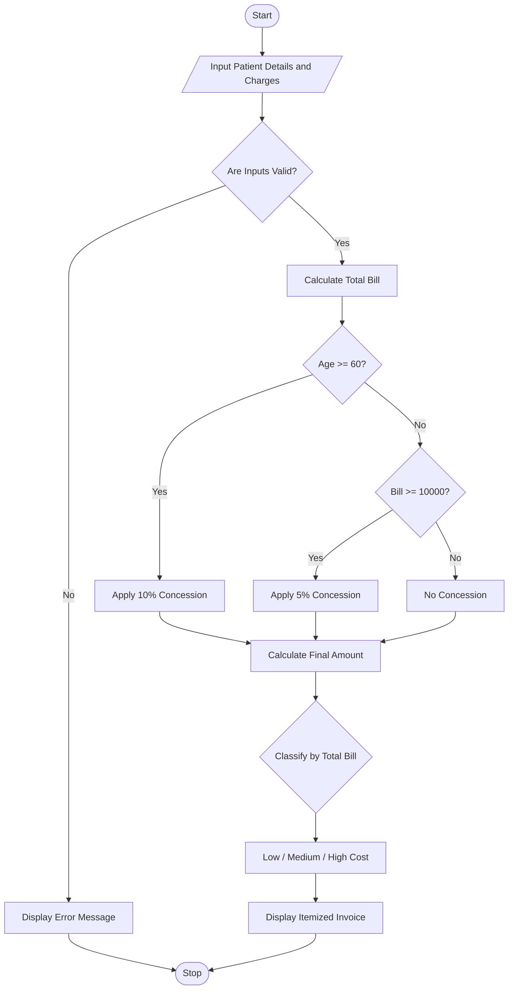

# Hospital Billing and Patient Classification Using Python

## 1. Problem Statement

Develop a Python program to calculate hospital bills based on consultation fees, diagnostic charges, and treatment costs. Apply conditional concessions according to the patient's category and total bill amount. Validate billing constraints, such as non-negative charges and valid patient details. Finally, classify patients according to a payment policy and display an itemized hospital invoice.

## 2. Algorithm

1. Start the program.
2. Input the patient's name, age, and patient category.
3. Enter consultation, diagnostic, and treatment charges.
4. Validate the patient details and ensure all charges are non-negative.
5. Calculate the total bill by adding all charges.
6. Apply concessions according to the following rules:
   - Senior citizens aged 60 or above receive a 10% concession.
   - Bills of ₹10,000 or more receive a 5% concession for other patients.
7. Calculate the final payable amount after applying the concession.
8. Classify the patient according to the payment policy:
   - Below ₹5,000: Low-cost patient.
   - ₹5,000–₹15,000: Medium-cost patient.
   - Above ₹15,000: High-cost patient.
9. Display the itemized invoice and patient classification.
10. Stop the program.

## 3. Flowchart Using Mermaid


## 5. Sample Input

```text
===== HOSPITAL BILLING SYSTEM =====
Enter patient name: Ravi
Enter patient age: 65
Enter patient category (General/Senior): Senior
Enter consultation charges: Rs. 1000
Enter diagnostic charges: Rs. 2000
Enter treatment charges: Rs. 8000
```

## 6. Sample Output

```text
========== HOSPITAL INVOICE ==========
Patient Name       : Ravi
Patient Age        : 65
Patient Category   : Senior
--------------------------------------
Consultation       : Rs. 1000.00
Diagnostics        : Rs. 2000.00
Treatment          : Rs. 8000.00
--------------------------------------
Total Bill         : Rs. 11000.00
Concession         : 10%
Concession Amount  : Rs. 1100.00
Final Amount       : Rs. 9900.00
Classification     : Medium-cost patient
======================================
```


