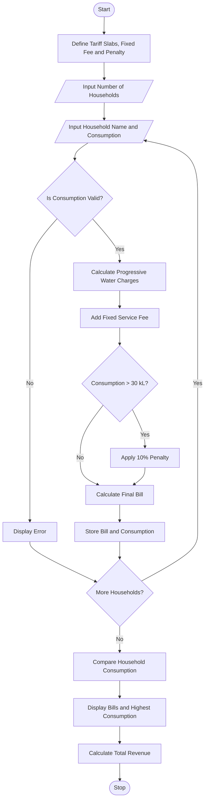

# Progressive Water Tariff Analysis Using Python

## 1. Problem Statement

Develop a Python program to calculate water bills for multiple households based on water consumption, progressive tariff slabs, fixed service fees, and penalties for excessive usage. The program should calculate charges for each consumption slab, identify households exceeding the specified usage limit, compare consumption patterns, and generate an itemized bill for every household. Finally, display the total revenue and identify the household with the highest water consumption.

## 2. Algorithm

1. Start the program.
2. Define progressive water tariff rates, fixed fees, and penalty rules.
3. Input the number of households.
4. For each household:
   - Enter the household name and water consumption in kilolitres (kL).
   - Validate the input.
   - Calculate water charges using progressive consumption slabs.
   - Add the fixed service fee.
   - Apply an additional penalty if consumption exceeds the specified limit.
   - Calculate the final bill.
   - Identify whether water usage is excessive.
5. Compare the consumption of all households.
6. Identify the household with the highest consumption.
7. Display each household's bill and consumption status.
8. Calculate and display total revenue.
9. Stop the program.

## 3. Flowchart Using Mermaid


      
## 5. Sample Input

```text
===== WATER TARIFF BILLING SYSTEM =====
Enter number of households: 3

Household 1
Enter household name: House A
Enter water consumption (kL): 8

Household 2
Enter household name: House B
Enter water consumption (kL): 18

Household 3
Enter household name: House C
Enter water consumption (kL): 35
```

## 6. Sample Output

```text
========== WATER BILL REPORT ==========

Household Name : House A
Consumption    : 8.00 kL
Water Charges  : Rs. 80.00
Fixed Fee      : Rs. 50.00
Penalty        : Rs. 0.00
Final Bill     : Rs. 130.00
Usage Status   : Normal Usage
--------------------------------------

Household Name : House B
Consumption    : 18.00 kL
Water Charges  : Rs. 220.00
Fixed Fee      : Rs. 50.00
Penalty        : Rs. 0.00
Final Bill     : Rs. 270.00
Usage Status   : Normal Usage
--------------------------------------

Household Name : House C
Consumption    : 35.00 kL
Water Charges  : Rs. 625.00
Fixed Fee      : Rs. 50.00
Penalty        : Rs. 62.50
Final Bill     : Rs. 737.50
Usage Status   : Excessive Usage
--------------------------------------

========== CONSUMPTION ANALYSIS ==========
Highest Consumption: House C (35.00 kL)
Lowest Consumption : House A (8.00 kL)
Total Revenue      : Rs. 1137.50

Excessive Usage Households:
House C
==========================================
```

## Result

The program calculates water bills using progressive tariff slabs, fixed service fees, and excessive-usage penalties. It compares consumption across multiple households, identifies the highest and lowest consumers, and calculates total revenue.
