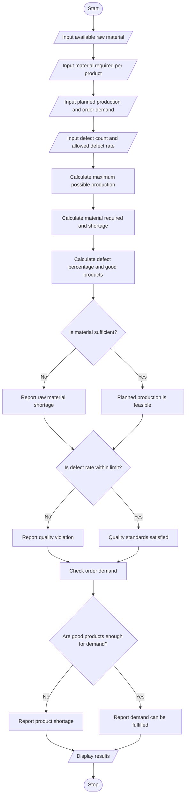

# 95. Integrated Manufacturing Production Planner

## 1. PROBLEM STATEMENT

Develop a Python program to analyze a manufacturing production plan based on available raw materials, planned production quantities, product defects, and customer order demand.

The program should:
- Accept available raw materials and material required per product.
- Calculate the maximum possible production quantity.
- Compare planned production with customer demand.
- Identify raw material shortages and product defects.
- Check whether the defect rate exceeds the allowed quality limit.
- Display production feasibility and suggest whether additional materials or quality improvements are needed.

## 2. ALGORITHM

1. Start the program.
2. Input the available raw material quantity.
3. Input the raw material required to manufacture one product.
4. Input the planned production quantity and customer order demand.
5. Input the number of defective products and the maximum allowed defect percentage.
6. Calculate the maximum possible production using the available materials.
7. Calculate the material required and identify any shortage.
8. Calculate the defect percentage.
9. Check production feasibility and quality compliance.
10. Calculate the shortage of finished products, if any.
11. Display the results.
12. Stop the program.

## 3. FLOWCHART (Mermaid)




## 5. SAMPLE INPUT

```text
Enter available raw material (kg): 500
Enter material required per product (kg): 2
Enter planned production quantity: 200
Enter customer order demand: 180
Enter number of defective products: 12
Enter maximum allowed defect rate (%): 5

## 6. SAMPLE OUTPUT

```text
=== Manufacturing Production Planner ===

--- Production Analysis ---
Maximum possible production: 250 units
Planned production: 200 units
Material required: 400.00 kg
Material shortage: 0.00 kg
Production feasibility: FEASIBLE
Defective products: 12
Defect rate: 6.00%
Good products: 188
Quality status: QUALITY VIOLATION
Customer order demand: 180 units
Product shortage: 0 units
Order status: DEMAND CAN BE FULFILLED
Recommendation: Improve the production quality process.


