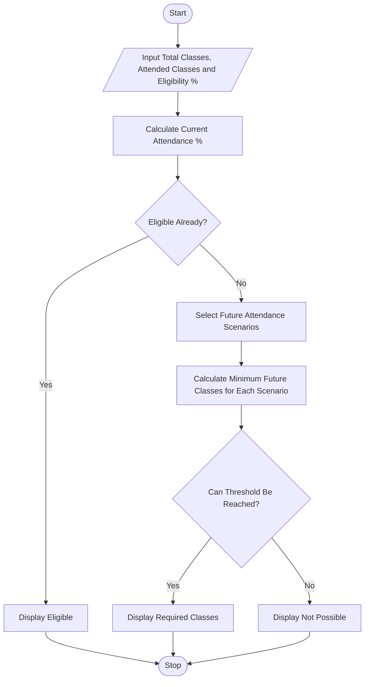

# Attendance Recovery Computation Using Python

## 1. Problem Statement

Develop a Python program to calculate a student's current attendance percentage and determine the minimum number of consecutive classes the student must attend to reach the required attendance eligibility threshold. The program should consider different future attendance scenarios, including attending all upcoming classes or attending only a certain percentage of them. It should display the current attendance percentage, required attendance percentage, and minimum number of future classes needed to achieve eligibility.

## 2. Algorithm

1. Start the program.
2. Input the total number of classes conducted.
3. Input the number of classes attended.
4. Input the required attendance percentage.
5. Calculate the current attendance percentage.
6. Check whether the student already meets the eligibility threshold.
7. If not eligible, calculate the minimum future classes required.
8. Consider future attendance scenarios, such as attending every class or attending a specified percentage.
9. Display the current attendance, eligibility status, and required future classes.
10. Stop the program.

## 3. Flowchart




## 5. Sample Input

```text
Enter total classes conducted: 40
Enter classes attended: 24
Enter required attendance percentage: 75


## 6. Sample Output

```text
Current Attendance: 60.00%
Required Attendance: 75.00%

--- Attendance Recovery Scenarios ---

Future attendance 100%:
Minimum future classes: 24
Expected final attendance: 75.00%

Future attendance 90%:
Minimum future classes: 40
Expected final attendance: 75.00%

Future attendance 80%:
Minimum future classes: 120
Expected final attendance: 75.00%


