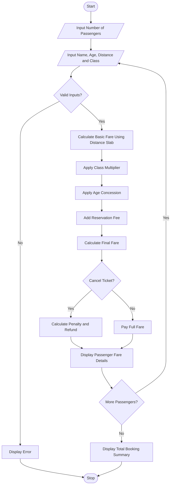

# Railway Fare and Reservation Calculator Using Python

## 1. Problem Statement

Develop a Python program to calculate railway fares for multiple passengers based on travel distance, travel class, age-based concessions, reservation fees, and cancellation penalties. The program should calculate the basic fare using distance slabs, apply eligible concessions, add reservation charges, and determine the refund amount when a ticket is cancelled. Finally, display an itemized fare summary for each passenger and the total booking amount.

## 2. Algorithm

1. Start the program.
2. Define fare rates for different travel classes.
3. Define distance slabs, age-based concessions, reservation fees, and cancellation penalties.
4. Input the number of passengers.
5. For each passenger:
   - Enter the passenger's name, age, distance, and travel class.
   - Validate the input details.
   - Calculate the basic fare using the distance and class rate.
   - Apply an age-based concession if eligible.
   - Add the reservation fee.
   - Calculate the final fare.
   - If cancellation is requested, calculate the cancellation penalty and refund.
6. Display the fare details for each passenger.
7. Calculate and display the total booking amount.
8. Stop the program.

## 3. Flowchart Using Mermaid

## 5. Sample Input

```text
===== RAILWAY FARE CALCULATOR =====
Enter number of passengers: 2

Passenger 1
Enter passenger name: Ravi
Enter age: 65
Enter travel distance (km): 300
Enter class (Sleeper/AC3/AC2/FirstAC): AC3
Cancel ticket? (yes/no): yes

Passenger 2
Enter passenger name: Anu
Enter age: 30
Enter travel distance (km): 600
Enter class (Sleeper/AC3/AC2/FirstAC): Sleeper
Cancel ticket? (yes/no): no
```

## 6. Sample Output

```text
========== RAILWAY FARE INVOICE ==========

Passenger Name : Ravi
Age            : 65
Distance       : 300.0 km
Travel Class   : AC3
Basic Fare     : Rs. 900.00
Concession     : Rs. 180.00
Reservation Fee: Rs. 40.00
Ticket Fare    : Rs. 760.00
Status         : Cancelled
Penalty        : Rs. 190.00
Refund         : Rs. 570.00
------------------------------------------

Passenger Name : Anu
Age            : 30
Distance       : 600.0 km
Travel Class   : SLEEPER
Basic Fare     : Rs. 720.00
Concession     : Rs. 0.00
Reservation Fee: Rs. 20.00
Ticket Fare    : Rs. 740.00
Status         : Confirmed
Amount Payable : Rs. 740.00
------------------------------------------
Total Booking Amount: Rs. 740.00
==========================================
```

## Result

The program calculates railway fares for multiple passengers using distance-based rates and travel class multipliers. It applies age-based concessions, adds reservation fees, calculates cancellation penalties and refunds, and displays an itemized fare summary.

**Note:** All rates, concessions, and cancellation penalties are illustrative. Actual railway fares, age concessions, and cancellation charges depend on the applicable railway rules.
