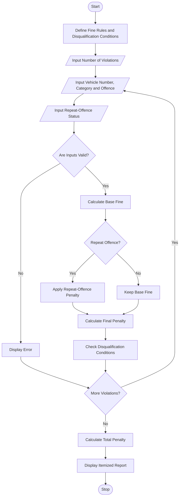

# Traffic Violation Penalty Calculator Using Python

## 1. Problem Statement

Develop a Python program to calculate traffic violation penalties for multiple offences based on vehicle category, offence type, repeat-offence status, and predefined fine rules. The program should apply additional penalties for repeat offences, calculate the total fine for each vehicle, and identify disqualification conditions when specified violation limits are exceeded. Finally, display an itemized penalty report for all violations.

*Note: The fines and disqualification thresholds used below are illustrative values for an academic programming exercise, not official traffic laws.*

## 2. Algorithm

1. Start the program.
2. Define the fine amounts for different offence types and vehicle categories.
3. Define the additional penalty for repeat offences.
4. Define the conditions for disqualification.
5. Input the number of violations.
6. For each violation:
   - Enter the vehicle registration number.
   - Enter the vehicle category.
   - Enter the offence type.
   - Specify whether it is a repeat offence.
   - Validate the input details.
   - Calculate the base fine.
   - Apply the repeat-offence penalty if applicable.
   - Calculate the final penalty.
   - Check whether the violation meets a disqualification condition.
7. Calculate the total penalty for all valid violations.
8. Display the itemized penalty report and disqualification status.
9. Stop the program.

## 3. Flowchart 

## 5. Sample Input

```text
===== TRAFFIC VIOLATION PENALTY CALCULATOR =====
Enter number of violations: 3

Violation 1
Vehicle registration number: AP01AB1234
Vehicle category (two_wheeler/car/heavy_vehicle): car
Offence (speeding/signal_jump/no_helmet/drunk_driving): speeding
Is this a repeat offence? (yes/no): yes

Violation 2
Vehicle registration number: AP01AB1234
Vehicle category (two_wheeler/car/heavy_vehicle): car
Offence (speeding/signal_jump/no_helmet/drunk_driving): signal_jump
Is this a repeat offence? (yes/no): no

Violation 3
Vehicle registration number: AP01AB1234
Vehicle category (two_wheeler/car/heavy_vehicle): car
Offence (speeding/signal_jump/no_helmet/drunk_driving): drunk_driving
Is this a repeat offence? (yes/no): no
```

## 6. Sample Output

```text
========== TRAFFIC PENALTY REPORT ==========

Vehicle Number : AP01AB1234
Category       : car
Offence        : speeding
Repeat Offence : yes
Final Penalty  : Rs. 3000.00
Status         : Disqualification condition met
---------------------------------------------

Vehicle Number : AP01AB1234
Category       : car
Offence        : signal_jump
Repeat Offence : no
Final Penalty  : Rs. 750.00
Status         : Disqualification condition met
---------------------------------------------

Vehicle Number : AP01AB1234
Category       : car
Offence        : drunk_driving
Repeat Offence : no
Final Penalty  : Rs. 7500.00
Status         : Disqualification condition met
---------------------------------------------

Total Penalty: Rs. 11250.00

Vehicle Disqualification Summary:
AP01AB1234: Disqualification condition met
=============================================
```

## Result

The program processes multiple traffic violations, calculates penalties according to vehicle categories and offence types, applies repeat-offence penalties, and identifies vehicles meeting the defined disqualification conditions.

**Note:** The fines, multipliers, and disqualification rules are illustrative. Actual penalties and driving-licence disqualification conditions depend on applicable traffic laws and the relevant authority's decisions.
