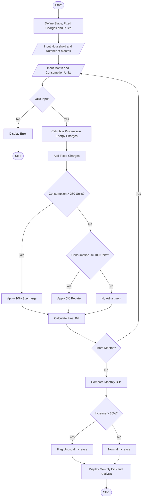

# Progressive Electricity Billing Using Python

## 1. Problem Statement

Develop a Python program to calculate household electricity bills using progressive consumption slabs, fixed charges, surcharges, and rebates. The program should calculate the energy charges for each slab, add fixed charges, apply surcharges when consumption exceeds a specified limit, and provide rebates when eligible. It should also compare electricity bills across several months and identify unusual increases in consumption or billing amounts.

## 2. Algorithm

1. Start the program.
2. Define electricity consumption slabs and their rates.
3. Define fixed charges, surcharge rules, and rebate rules.
4. Input the household name and number of months.
5. For each month:
   - Enter the month name and electricity consumption in units (kWh).
   - Validate the input.
   - Calculate energy charges using progressive slabs.
   - Add fixed charges.
   - Apply a surcharge if consumption exceeds the specified limit.
   - Apply a rebate if consumption is below the specified limit.
   - Calculate the final bill.
6. Compare each month's bill with the previous month's bill.
7. Identify unusual increases when the bill rises by more than 30%.
8. Display the monthly bill details and total amount payable.
9. Stop the program.

## 3. Flowchart Using Mermaid



    
   

## 5. Sample Input

```text
===== ELECTRICITY BILLING SYSTEM =====
Enter household name: House A
Enter number of months: 3

Month 1
Enter month name: January
Enter electricity consumption (kWh): 80

Month 2
Enter month name: February
Enter electricity consumption (kWh): 150

Month 3
Enter month name: March
Enter electricity consumption (kWh): 280
```

## 6. Sample Output

```text
========== MONTHLY ELECTRICITY BILLS ==========
Household: House A

Month       : January
Units       : 80.00 kWh
Energy Cost : Rs. 160.00
Fixed Charge: Rs. 50.00
Surcharge   : Rs. 0.00
Rebate      : Rs. 8.00
Final Bill  : Rs. 202.00
----------------------------------------

Month       : February
Units       : 150.00 kWh
Energy Cost : Rs. 350.00
Fixed Charge: Rs. 50.00
Surcharge   : Rs. 0.00
Rebate      : Rs. 0.00
Final Bill  : Rs. 400.00
----------------------------------------

Month       : March
Units       : 280.00 kWh
Energy Cost : Rs. 900.00
Fixed Charge: Rs. 50.00
Surcharge   : Rs. 90.00
Rebate      : Rs. 0.00
Final Bill  : Rs. 1040.00
----------------------------------------

========== BILL COMPARISON ==========
January to February: 98.02% change
WARNING: Unusual bill increase detected!
February to March: 160.00% change
WARNING: Unusual bill increase detected!

Total Amount: Rs. 1642.00
====================================
```

## Result

The program calculates electricity bills using progressive tariff slabs, fixed charges, surcharges, and rebates. It compares monthly bills and identifies unusual increases greater than 30%.

**Note:** The electricity rates and adjustment rules are illustrative values for this programming exercise. Actual tariffs vary by electricity provider and consumer category.
