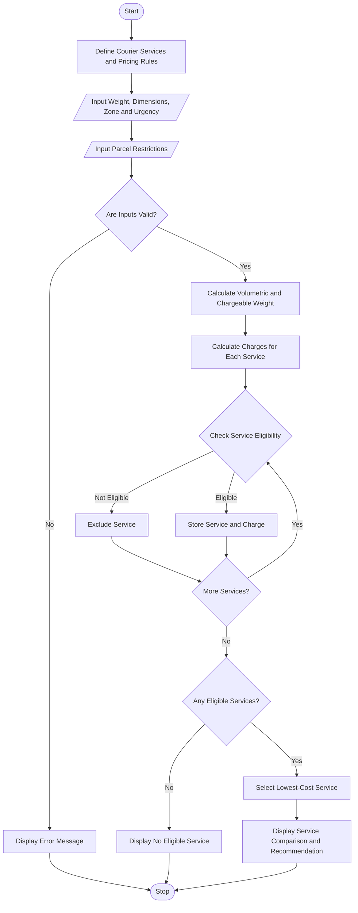

# Courier Charge Optimization Using Python

## 1. Problem Statement

Develop a Python program to calculate courier delivery charges based on parcel weight, dimensions, delivery distance zone, urgency, and declared restrictions. The program should calculate the charge for each available courier service, check whether the parcel meets the service's eligibility requirements, compare the eligible options, and select the most economical service. Finally, display the parcel details, charges, eligible services, and recommended courier option.

## 2. Algorithm

1. Start the program.
2. Define courier service rates, distance zones, urgency charges, and parcel restrictions.
3. Input the parcel's weight, length, width, height, destination zone, urgency, and declared restrictions.
4. Validate the input details.
5. Calculate the parcel's volumetric weight using its dimensions.
6. Determine the chargeable weight as the greater of actual weight and volumetric weight.
7. Calculate delivery charges for each courier service.
8. Check each service's weight, size, and restriction limits.
9. Exclude services that cannot accept the parcel.
10. Compare the charges of the eligible services.
11. Select the service with the lowest charge.
12. Display the eligible services, their charges, and the recommended option.
13. Stop the program.

## 3. Flowchart Using Mermaid



## 6. Sample Output

```text
Volumetric Weight: 1.2 kg
Chargeable Weight: 2.0 kg

========== SERVICE COMPARISON ==========
Basic: Not eligible (restriction)
Express: Rs. 310.00 (Eligible)
Premium: Not eligible (restriction)

========== RECOMMENDATION ==========
Recommended Service: Express
Delivery Charge: Rs. 310.00
=====================================
```

### Calculation

For the Express service:

- Chargeable weight = 2 kg
- Express rate = ₹60 per kg
- Regional multiplier = 1.5
- Express surcharge = ₹100
- Fragile handling fee = ₹30

**Total = (2 × ₹60 × 1.5) + ₹100 + ₹30 = ₹310.**

## Result

The program calculates courier charges based on parcel dimensions, chargeable weight, destination zone, urgency, and declared restrictions. It compares available services, excludes ineligible options, and recommends the lowest-cost eligible service.

**Note:** The service prices and restrictions are examples for academic use. Real courier providers may use different volumetric-weight divisors, pricing structures, and acceptance policies.
